<div align="center">

# 🧠 NeuroSphere 3D

**Interactive brain anatomy lab — rotate, slice and dissect a real segmented human brain, learn what every structure does, and see how neurological diseases relate to it.**

[](https://github.com/HeyNerveStem/NeuroSphere/actions/workflows/ci.yml)
[](https://heynervestem.github.io/NeuroSphere/)


 

### [▶ Open the live demo](https://heynervestem.github.io/NeuroSphere/)

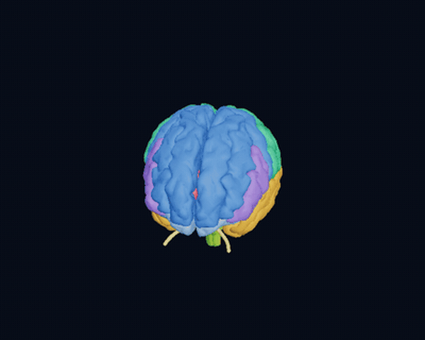

<sub>Deterministic layer-by-layer disassembly: cortex → deep cortex & white matter → subcortical nuclei → diencephalon → brainstem → cerebellum.</sub>

</div>

> [!IMPORTANT]
> NeuroSphere 3D is intended for anatomy and neuroscience education. It does not provide medical diagnosis, personalized treatment recommendations, or emergency medical services. Medical content is marked **Draft** until reviewed by a qualified clinician.

---

## Contents

[Highlights](#highlights) · [Screenshots](#screenshots) · [Quick start](#quick-start) · [Commands](#commands) · [Project structure](#project-structure) · [Architecture](#architecture) · [API](#api) · [Testing](#testing) · [Performance](#performance) · [Limitations](#known-limitations) · [License](#license)

## Highlights

|                               |                                                                                                                                                                                                                             |
| ----------------------------- | --------------------------------------------------------------------------------------------------------------------------------------------------------------------------------------------------------------------------- |
| 🧩 **Real segmented anatomy** | 86 independently selectable structures from the peer-reviewed [BodyParts3D](https://doi.org/10.1093/nar/gkn613) database. Structures the asset lacks are listed as _unavailable_, never faked.                              |
| 🔬 **Anatomy Lab**            | Orbit / pan / zoom, double-click to focus, 9 anatomical camera presets, sagittal / coronal / axial section planes, X-ray cortex, hide / isolate / opacity, realistic or region colours, live 3D labels, orientation widget. |
| ✋ **Manual dissection**      | Drag or rotate any structure with a 3D gizmo — snapping, lock, undo / redo, exact _return to original_ and _reassemble all_.                                                                                                |
| 💥 **Exploded view**          | 4 modes (complete, layer-by-layer, selected region, guided with captions), scrubbable timeline, play / pause / reverse / step, 0.25×–2× speed, explosion-distance slider — fully deterministic.                             |
| 📖 **Information panel**      | Overview, description, functions, connections (with _show connected regions_), clinical significance, related conditions with evidence level, real references — depth adapts to beginner / intermediate / advanced.         |
| 🩺 **Disease Explorer**       | 34 conditions in 8 clinical categories, 18 sections each, scoped structure–disease associations shown on the 3D model, 7 labelled educational animations.                                                                   |
| 🎓 **Guided learning**        | 10 tours that drive the same viewer, with progress tracking, optional narration and quizzes.                                                                                                                                |
| 🔎 **Unified search**         | Structures, synonyms, functions, diseases, symptoms and lessons from one search box.                                                                                                                                        |
| ⚙️ **Backend**                | FastAPI + SQLAlchemy content API (SQLite; PostgreSQL-compatible). The viewer and all content also work fully offline.                                                                                                       |

## Screenshots

<table>
<tr>
<td width="50%">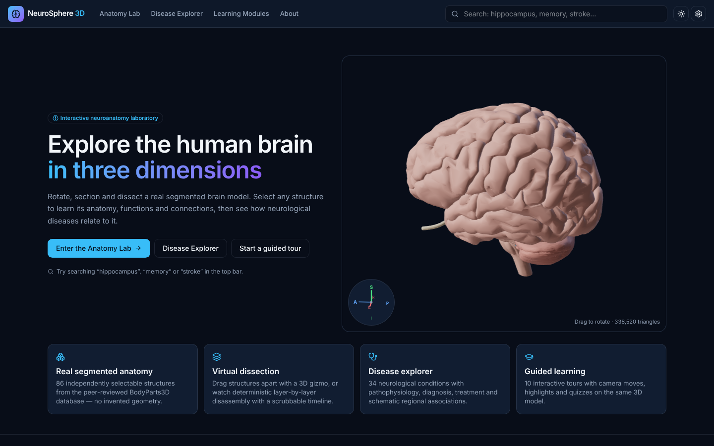<br><b>Home</b> — live, auto-rotating 3D preview</td>
<td width="50%">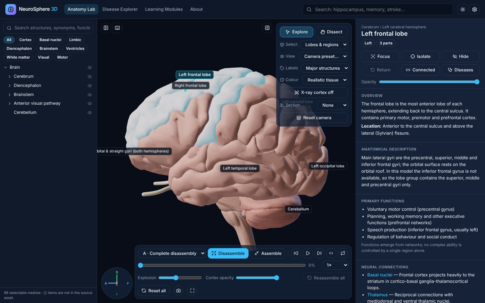<br><b>Anatomy Lab</b> — hierarchy, viewport, info panel, toolbar</td>
</tr>
<tr>
<td>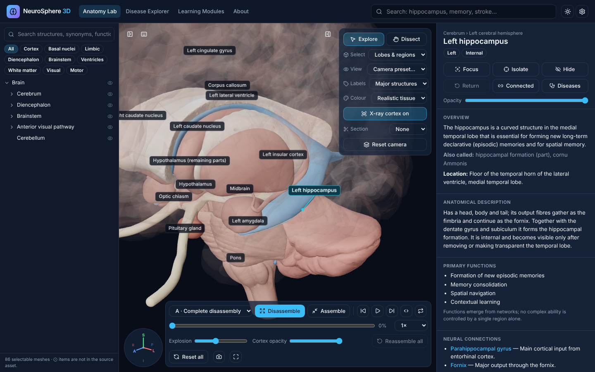<br><b>X-ray</b> — deep-linking to the hippocampus reveals it through the cortex</td>
<td>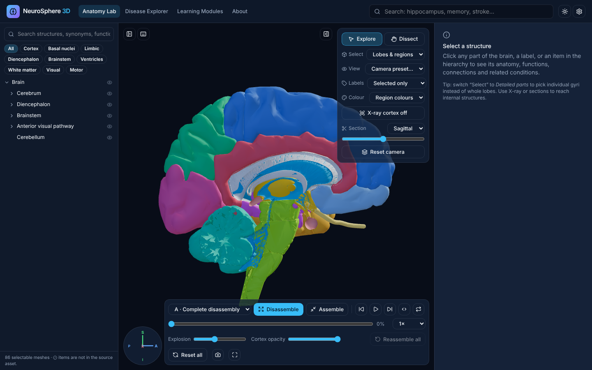<br><b>Section planes</b> — midline sagittal cut in region colours</td>
</tr>
<tr>
<td>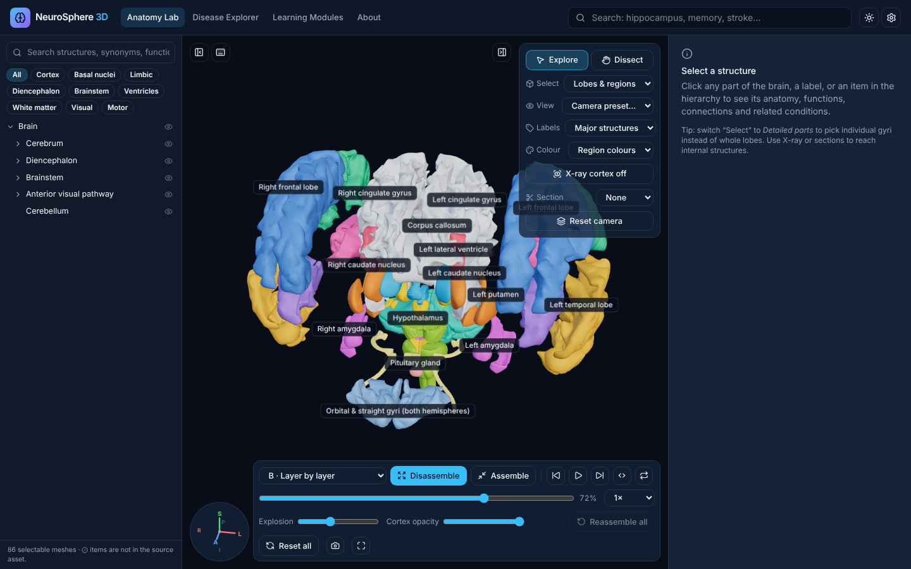<br><b>Exploded view</b> — layer-by-layer at 72 %, major-structure labels</td>
<td>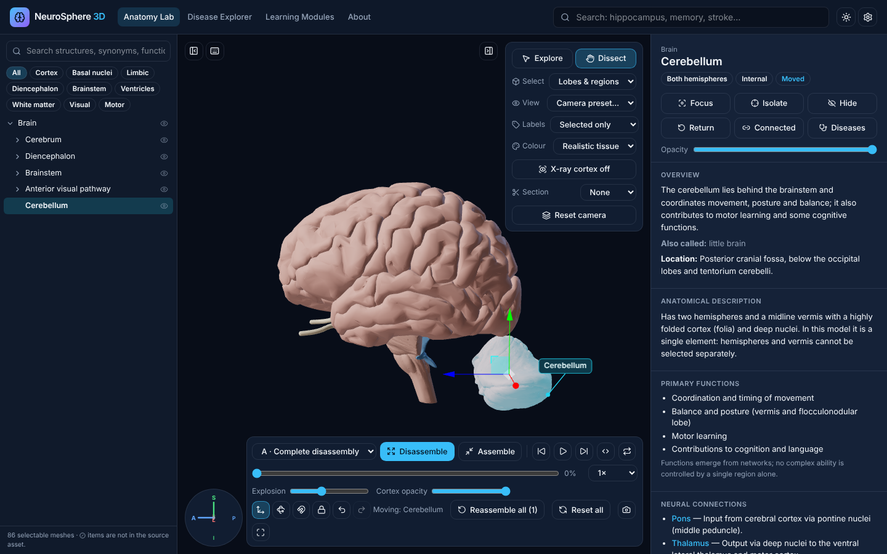<br><b>Manual dissection</b> — cerebellum pulled away with the gizmo</td>
</tr>
<tr>
<td>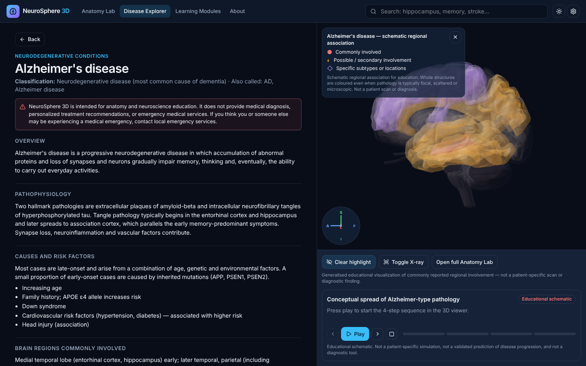<br><b>Disease page</b> — Alzheimer's disease, affected regions highlighted</td>
<td>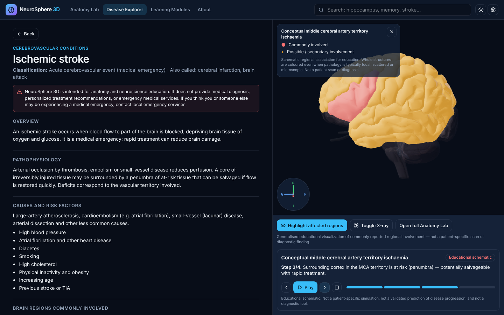<br><b>Educational schematic</b> — MCA-territory ischaemic stroke, step 3 / 4</td>
</tr>
<tr>
<td>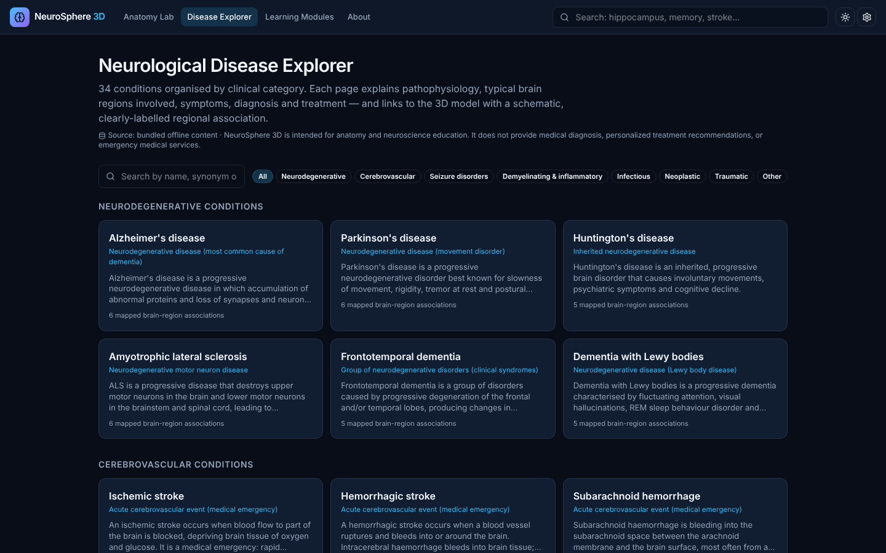<br><b>Disease Explorer</b> — 34 conditions by clinical category</td>
<td>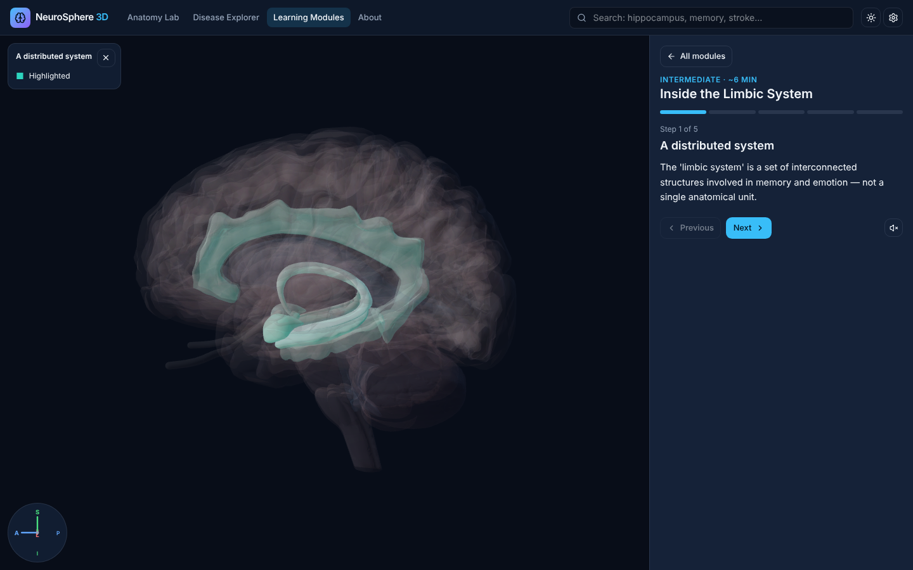<br><b>Guided tour</b> — limbic system, driving the same viewer</td>
</tr>
<tr>
<td>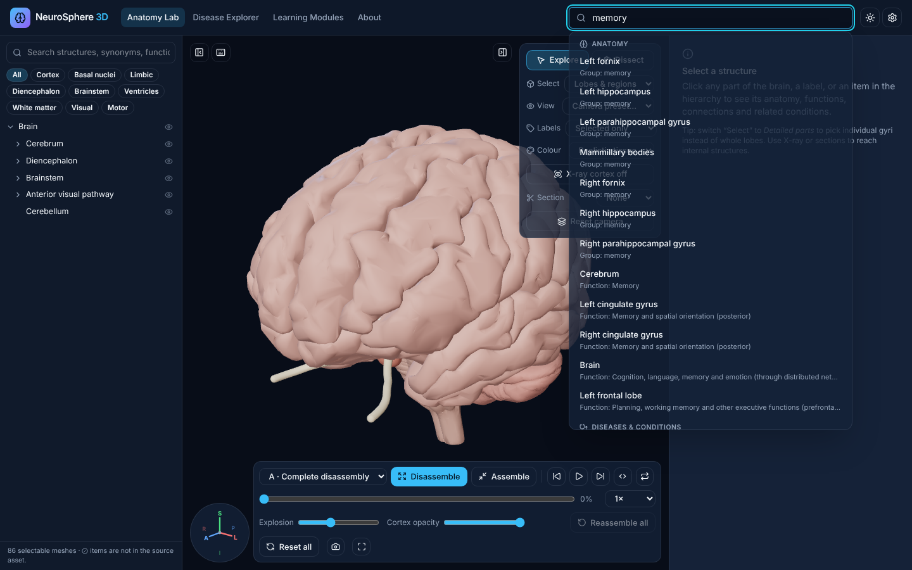<br><b>Unified search</b> — “memory” across anatomy, diseases, symptoms, lessons</td>
<td align="center">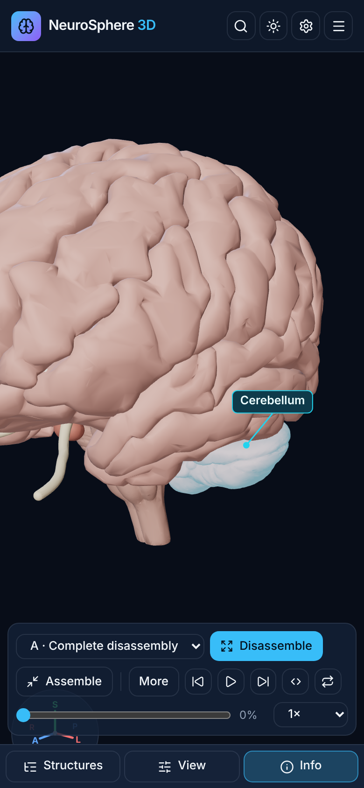<br><b>Mobile</b> — touch gestures and bottom sheets</td>
</tr>
</table>

<sub>All images are captured from the real app by <code>scripts/dev/capture_demo.py</code> (<code>make screenshots</code>).</sub>

## Quick start

**Requirements:** Node 20+ and Python 3.11+.

```bash
git clone https://github.com/HeyNerveStem/NeuroSphere.git
cd NeuroSphere

# 1 · backend (terminal 1)
cd backend
python3 -m venv .venv && source .venv/bin/activate
pip install -r requirements.txt
uvicorn app.main:app --reload --port 8000      # API docs → http://127.0.0.1:8000/api/docs

# 2 · frontend (terminal 2)
cd frontend
npm ci
npm run dev                                     # → http://localhost:5173  (proxies /api → :8000)
```

The processed brain model (`frontend/public/models/brain.glb`) is committed, so you **don't** need the source STLs or any 3D tools to run the app. The frontend also runs on its own — without the backend it uses the bundled content.

## Commands

A root `Makefile` wraps everything (`make help`):

| Task                      | Make                            | Direct                                                                 |
| ------------------------- | ------------------------------- | ---------------------------------------------------------------------- |
| Install dependencies      | `make setup`                    | `npm ci` · `pip install -r requirements.txt`                           |
| Run backend / frontend    | `make dev-api` · `make dev-web` | `uvicorn app.main:app --reload` · `npm run dev`                        |
| Production build          | `make build`                    | `cd frontend && npm run build`                                         |
| Static offline demo build | `make demo`                     | `npm run build:demo` (hash routing, no API — what GitHub Pages serves) |
| Validators + unit tests   | `make test`                     | `npm run typecheck && npm test` · `pytest -q`                          |
| Browser acceptance tests  | `make test-e2e`                 | `npm run build && npx playwright test`                                 |
| Lint / format             | `make lint` · `make format`     | ESLint + Prettier · Ruff                                               |
| Rebuild the 3D model      | `make model`                    | `fetch_bodyparts3d.sh && build_model.sh`                               |
| Regenerate screenshots    | `make screenshots`              | `python3 scripts/dev/capture_demo.py`                                  |

## Project structure

```
NeuroSphere/
├── frontend/                    React 19 · TypeScript (strict) · Vite · Tailwind 4 · React Three Fiber
│   ├── public/models/brain.glb  processed, meshopt-compressed model (1.66 MB)
│   ├── src/
│   │   ├── three/               BrainScene · BrainModel (meshes, materials, BVH picking)
│   │   │                        TransformManager (single authoritative transform + exploded view)
│   │   │                        CameraController · DissectionGizmo · LabelManager
│   │   ├── components/          layout · anatomy · viewer · animation · diseases · learning · ui
│   │   ├── stores/              viewerStore · animationStore · transformStore (Zustand)
│   │   ├── lib/                 anatomy index · deterministic explode math · search · disease viz
│   │   ├── pages/               Home · AnatomyLab · DiseaseCatalog/Detail · Learn/Module · About · Settings
│   │   └── services/            optional content-API client (falls back to bundled content)
│   └── e2e/                     Playwright acceptance tests
├── backend/app/                 FastAPI · Pydantic · SQLAlchemy — api/ models/ schemas/ services/ database/
├── content/                     single source of truth: structures, anatomy, diseases, relationships,
│                                references, learning modules, disease animations (JSON)
├── assets/                      model-manifest.json · attribution/ · licenses/ · source-models/ (git-ignored STLs)
├── scripts/                     model-optimization/ · model-validation/ · content-validation/ · dev/  (see scripts/README.md)
├── docs/                        architecture · anatomy-assets · animation-system · medical-content-sources · deployment
├── .github/workflows/           ci.yml (lint, validate, test, build) · pages.yml (live demo)
└── Makefile                     one-command tasks
```

## Architecture

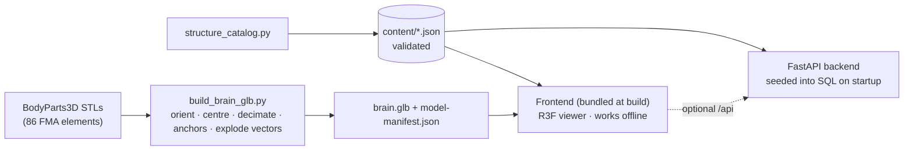

- **One authoritative transform per structure**, composed every frame: `position = original + explode(progress) + manualOffset (+ lesion push)`. The original is never mutated, so _return to original_ snaps back exactly — no drift.
- **Deterministic exploded view**: per-group direction vectors computed at build time; scrubbing is a pure function of timeline progress.
- **Coordinate frame**: +X patient left, +Y superior, +Z anterior. The model validator enforces orientation invariants (left structures on +X, frontal anterior to occipital, medulla below pons, …).
- **Scoped disease associations**: hemisphere-wide associations are not pushed down onto small structures (e.g. metastases are not listed under the hippocampus).

Details: [docs/architecture.md](docs/architecture.md) · [docs/animation-system.md](docs/animation-system.md) · [docs/anatomy-assets.md](docs/anatomy-assets.md)

## Routes

| Route                                | Page                                                                        |
| ------------------------------------ | --------------------------------------------------------------------------- |
| `/`                                  | Home with live 3D preview                                                   |
| `/anatomy` · `/anatomy/:structureId` | Anatomy Lab (deep links focus the camera, auto-X-ray for buried structures) |
| `/diseases` · `/diseases/:diseaseId` | Disease catalog · disease page with 3D visualization                        |
| `/learn` · `/learn/:moduleId`        | Learning modules · guided tour + quiz                                       |
| `/about` · `/settings`               | Sources, licenses, disclaimers · quality, theme, level, labels, motion      |

## API

OpenAPI docs at **`/api/docs`** when the backend is running.

| Endpoint                                                   | Description                                                                     |
| ---------------------------------------------------------- | ------------------------------------------------------------------------------- |
| `GET /api/health`                                          | Status, DB dialect, content hash, record counts                                 |
| `GET /api/anatomy/structures`                              | List — filters `kind`, `group`, `hemisphere`, `parent`, `q`; `limit` / `offset` |
| `GET /api/anatomy/structures/{id}`                         | Detail: content, geometry metadata, mesh ids, references, related diseases      |
| `GET /api/anatomy/structures/{id}/diseases`                | Scoped structure–disease relationships                                          |
| `GET /api/anatomy/groups`                                  | Anatomical group tags with counts                                               |
| `GET /api/diseases` · `/api/diseases/{id}`                 | Catalog (`category`, `q`, pagination) · full disease page                       |
| `GET /api/diseases/{id}/structures`                        | Associations with type, distribution, evidence, resolved meshes                 |
| `GET /api/search?q=`                                       | Unified search: structures, diseases, symptoms, modules                         |
| `GET /api/learning/modules` · `/api/learning/modules/{id}` | Tours and quizzes                                                               |

## Testing

| Suite                     | Count     | Covers                                                                                                                                                                                                             |
| ------------------------- | --------- | ------------------------------------------------------------------------------------------------------------------------------------------------------------------------------------------------------------------ |
| Playwright (real browser) | 11 tests  | All 14 acceptance scenarios from the spec — real mouse clicks on rendered meshes, a real gizmo drag, timeline scrub, reverse, search focus, reset, mobile, content integrity — plus frontend ↔ backend integration |
| Vitest                    | 35 tests  | Explode math determinism, transform return with zero drift, undo / redo, animation store, content integrity, search, surface vs buried classification, InfoPanel & StructureTree components                        |
| pytest                    | 12 tests  | Every API endpoint, filters, pagination, 404 / 422 errors, OpenAPI paths, association scoping                                                                                                                      |
| Validators                | 2 scripts | Model: mesh ids, FMA mapping, finite transforms, orientation, label anchors. Content: references exist, every target resolves to real meshes, no unsourced statistics                                              |

CI runs lint, formatting checks, both validators, Vitest, pytest and a production build on every push.

## Performance

| Metric                                       | Value                                                                  |
| -------------------------------------------- | ---------------------------------------------------------------------- |
| Model                                        | 86 meshes · 336,520 triangles · **1.66 MB** GLB (meshopt)              |
| JS transferred (Anatomy Lab)                 | ≈ 495 KB gzipped                                                       |
| Time to model ready (local, headless Chrome) | ≈ 3 s                                                                  |
| Per-frame work                               | Transforms, labels and orientation widget update outside React renders |

GPU frame rates have not been measured yet; the only frame timings so far come from a CPU-only software renderer (worst case). A quality selector (Low → Ultra) caps pixel ratio and antialiasing for low-powered devices.

## Known limitations

1. **Not clinically reviewed.** All anatomy and disease text is marked _Draft_ pending sign-off by a qualified clinician or neuroanatomist. References are real, verified public sources; no statistics are stated without a source.
2. **Asset coverage.** BodyParts3D has no separate cerebellar hemispheres / vermis, no inferior frontal gyrus (a visible gap on the lateral frontal surface), and no separate substantia nigra, nucleus accumbens, medial occipital subdivisions, cranial nerves III–XII or tractography. These appear as _unavailable_ in the UI; Parkinson's highlights use the midbrain region containing the nigra, labelled as schematic.
3. **Schematic disease visualization.** Whole meshes are coloured even when pathology is focal or microscopic — labelled in the UI.
4. Single adult male surface model, not an MRI atlas. Label occlusion uses heuristics, not per-frame raycasts.
5. PostgreSQL compatibility is by design but untested against a live server.

Roadmap: CIT168 / Harvard-Oxford subcortical labels (substantia nigra, accumbens, subthalamic nucleus), a cerebellar lobule atlas, a cortical parcellation for the inferior frontal gyrus, tractography, clinician review workflow, accounts and LOD meshes.

## License

- **Code** (frontend, backend, scripts) — [MIT](LICENSE).
- **3D brain model** (`frontend/public/models/brain.glb`, `assets/model-manifest.json`) — derivative of BodyParts3D, distributed under **CC BY-SA 2.1 JP**, not MIT:

  > BodyParts3D, (c) The Database Center for Life Science licensed under CC Attribution-Share Alike 2.1 Japan

  Mitsuhashi N, et al. _Nucleic Acids Res._ 2009;37:D782–5. doi:[10.1093/nar/gkn613](https://doi.org/10.1093/nar/gkn613). Keep this attribution with any redistribution — see [assets/attribution/ATTRIBUTION.md](assets/attribution/ATTRIBUTION.md).

- **Educational content** (`content/`) — original text citing NINDS, MedlinePlus, NCBI Bookshelf, OpenStax and others; see [docs/medical-content-sources.md](docs/medical-content-sources.md).
